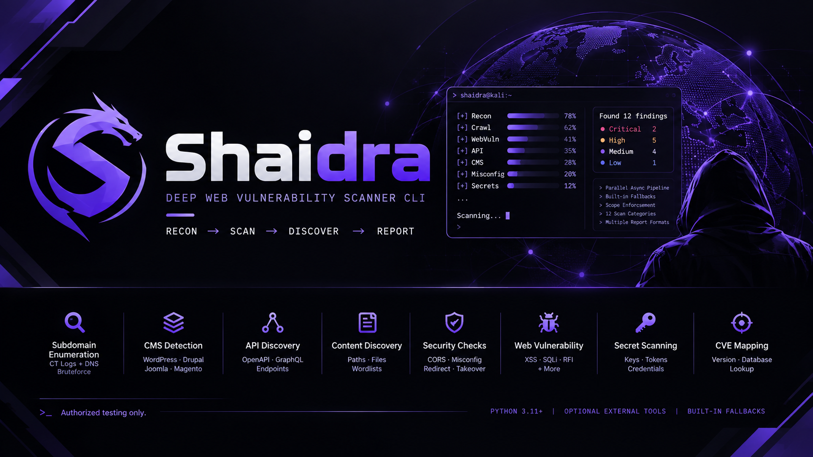

<p align="center">
  
</p>

<p align="center">
  <a href="https://github.com/santstyle/Shaidra/actions/workflows/ci.yml"></a>
  
  <a href="LICENSE"></a>
</p>

# Shaidra

Deep web vulnerability scanner CLI. Shaidra runs a parallel `asyncio` pipeline
of recon and scanning tasks with a live, nmap-style terminal UI, and reports
differently-severed findings at the end. It is built to work usefully **with or
without** external security tools installed.

> **Authorized testing only.** Use Shaidra solely against systems you own or
> have explicit written permission to test (bug bounty scope, lab ranges,
> engagements). You are responsible for your traffic.

## Features

- **Live parallel pipeline** — every stage runs concurrently with a real-time
  progress view and severity summary at the end.
- **12 scan categories** — `api`, `cms`, `content`, `cors`, `cve`, `jwt`,
  `misconfig`, `recon`, `redirect`, `secrets`, `takeover`, `webvuln`; select a
  subset with `--categories`.
- **Built-in fallbacks** — when an external tool is missing, Shaidra uses its
  own engine instead of skipping the stage: subdomain enumeration from
  Certificate Transparency logs (crt.sh, hackertarget) plus a DNS-wordlist
  brute-force with a wildcard-DNS guard, a TCP connect port scan over common
  ports, a same-origin spider that records
  HTML forms and also mines endpoints from `robots.txt`, `sitemap.xml`, and
  JavaScript bundles (so JavaScript-driven apps are not missed), wordlist
  probing, API/CMS/misconfiguration path checks, a leaked-credential scanner,
  form-aware web-vuln probes, and a built-in version-to-CVE matcher. The
  built-in web-vuln engine submits both GET query strings and POST form fields
  to detect reflected XSS, SQL injection, OS command injection, path traversal /
  LFI, SSTI, and in-band XXE; when a dynamic endpoint exposes no parameter it
  seeds common names so the detectors still have something to test. It also
  flags state-changing forms with no anti-CSRF token and confirms SSRF through
  an out-of-band callback listener — nothing destructive is sent.
- **Scope enforcement** — discovered hosts outside your scope file are never
  actively scanned.
- **Adaptive rate limiting** — 40 req/s by default, halved automatically when a
  WAF is detected.
- **Quiet by default** — nothing is written to disk unless you pass an `-o`
  report flag.

## Installation

Requirements: **Python 3.11+**.

```bash
pip install -e .        # or: pipx install .
shaidra --version
```

External tools are optional. Each one found on `PATH` upgrades its stage;
missing ones are replaced by the built-in fallback. Supported tools:
`subfinder`, `assetfinder`, `httpx`, `naabu`, `katana`, `gau`, `waybackurls`,
`nuclei`, `dalfox`, `sqlmap`, `ffuf`, `feroxbuster`, `wpscan`, `testssl.sh`,
`kiterunner`, `gowitness`, `wafw00f`, `whatweb`, `jwt_tool`, `subjack`.

Prefer the external tools? Let Shaidra fetch them for you:

```bash
shaidra --install-tools                 # install every missing tool, then exit
shaidra --install-tools example.com     # install first, then run the scan
```

Installs land in a per-user directory (`%LOCALAPPDATA%\shaidra\bin` on
Windows, `~/.local/share/shaidra/bin` elsewhere) and need no admin rights.
Shaidra adds that directory to `PATH` for the current run, so downloads are
usable immediately. Release binaries are pulled from each project's GitHub
releases (with a `go install` fallback when Go is available).

## Quick start

```bash
# Scan a URL, host, or host:port
shaidra https://example.com
shaidra http://192.0.2.10:8080

# Restrict to a scope file (one domain, IP, wildcard, or CIDR per line)
shaidra https://example.com --scope scope.txt

# Run only specific categories
shaidra https://example.com -c recon,webvuln

# Write reports (JSON / Markdown / plain text)
shaidra https://example.com -oA
```

The live view shows every stage's progress and each finding as it is
confirmed. The final summary groups findings by severity.

## Usage

```
shaidra [OPTIONS] TARGET
```

| Option | Description |
| ------ | ----------- |
| `-s, --scope FILE` | Scope file: one domain, IP, wildcard, or CIDR per line |
| `-c, --categories LIST` | Comma-separated categories (default: all) |
| `-r, --rate-limit N` | Requests per second (default: 40) |
| `--threads N` | Concurrency for fuzzing tools |
| `-m, --mode MODE` | `quick` (default) or `deep`: deep widens crawl depth, port sweep, and probe budgets |
| `-x, --extended` | Enable heavy checks: full-page screenshots and the entire content wordlist |
| `--config FILE` | Path to a `config.yaml` |
| `-v, --verbose` | Show discovered hosts and extra detail |
| `-q, --quiet` | Suppress live output |
| `-o, --output FMT` | Report format(s): `J`, `M`, `T`, `A` (repeatable) |
| `--output-dir DIR` | Directory for report files |
| `--output-name NAME` | Base name for report files |
| `--install-tools` | Download and install missing external tools into a per-user bin dir (no admin needed) |
| `--version` | Show the version and exit |

### Scan modes

`--mode deep` raises the per-stage coverage budgets so more of the target is
reached: the built-in spider crawls deeper (depth 3 → 6) and keeps more pages,
URLs, JavaScript bundles, and forms; the built-in TCP port scan widens from the
common-port set to the full 1–1024 range plus that set; and the built-in
content, web-vuln, and subdomain-probing budgets grow proportionally. Reach for
it when a quick pass misses real routes on a large application.

`--extended` enables heavier, slower checks: full-page screenshots (via
gowitness) and probing the **entire** content wordlist instead of the capped
subset.

### Reports

Reports are written **only** when you pass `-o`:

```bash
shaidra example.com -oJ                     # JSON only
shaidra example.com -oA                     # JSON + Markdown + TXT
shaidra example.com -oJ -oM -oT -oA         # formats combine
shaidra example.com -oJ --output-dir out --output-name my-run
```

## Scan pipeline

| Stage | What it does |
| ----- | ------------ |
| `recon` | Live-host probing; subdomain enumeration via available tools, or built-in Certificate Transparency lookups + DNS wordlist brute-force; port scan via naabu or a built-in TCP connect scan over common ports |
| `crawl` | URL discovery feeding the webvuln and redirect stages (katana/archives, or the built-in spider, which also mines robots.txt, sitemap.xml, and JavaScript) |
| `content` | Content discovery via ffuf/feroxbuster, or built-in wordlist probing |
| `api` | Probes Swagger/OpenAPI, GraphQL, Actuator, and OpenID paths |
| `cms` | Fingerprints WordPress/Drupal/Joomla/Magento and runs their checks |
| `misconfig` | Sensitive files and misconfiguration probes |
| `cors` | Tests for permissive / reflected-origin CORS policies |
| `jwt` | Inspects JWT tokens found while crawling |
| `webvuln` | nuclei templates + dalfox XSS, or built-in form-aware XSS / SQLi / command-injection / LFI / SSTI / XXE probes with common-parameter seeding for parameter-less endpoints, anti-CSRF token checks, and out-of-band SSRF confirmation |
| `redirect` | Open-redirect checks on crawled parameterized URLs |
| `takeover` | Subdomain takeover fingerprints on discovered hostnames |
| `cve` | Maps detected software versions to known CVEs — nuclei's CVE templates, or a built-in version-to-CVE table when nuclei is absent |
| `secrets` | Scans crawled assets and responses for leaked credentials, API keys, and tokens |

## Configuration

Configuration resolves in this order (first found wins):

1. `--config PATH`
2. `$SHAIDRA_CONFIG`
3. `./config.yaml`
4. the `config.yaml` shipped with the package

Every key is optional and falls back to the built-in defaults. Never put
credentials in `config.yaml`; read secrets from environment variables.

## Safety guardrails

- Discovery results outside your scope file are excluded from active scanning.
- The built-in subdomain enumeration queries third-party Certificate
  Transparency services (crt.sh, hackertarget) with a bare client, so target
  auth headers (`--cookie` / `-H`) are never sent to them; only the target's
  own hostnames are used.
- The rate limit defaults to 40 req/s and is halved automatically when a WAF is
  detected.
- Built-in web-vuln checks are non-destructive: reflection markers, shell echo
  markers, file-read path payloads, and detection-only SQLi quotes. They probe
  both GET query strings and POST form fields; no writes, uploads, or data
  dumps are sent.
- The out-of-band callback listener binds loopback by default and the injected
  URL is only ever sent to the target's own parameters. To verify SSRF against
  a remote target, set `oob_host` in the config to a host you control that
  forwards to Shaidra's listener.
- `sqlmap` runs only in detection-only mode (`--batch --level=1 --risk=1`);
  Shaidra never dumps data or writes to a target.
- `wpscan` runs only when WordPress is detected; `gowitness` and full wordlists
  run only with `--extended`.

## License

[MIT](LICENSE)
